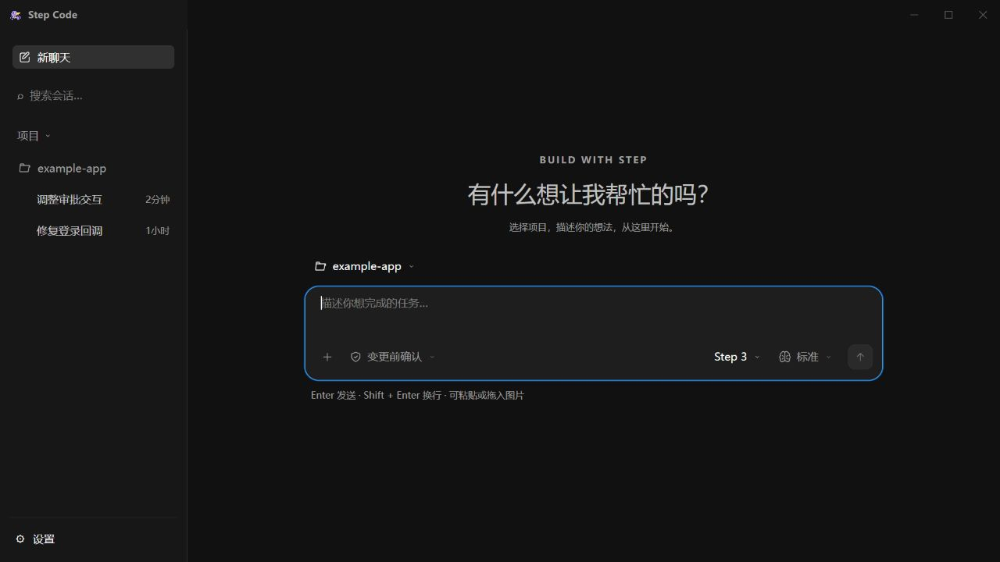
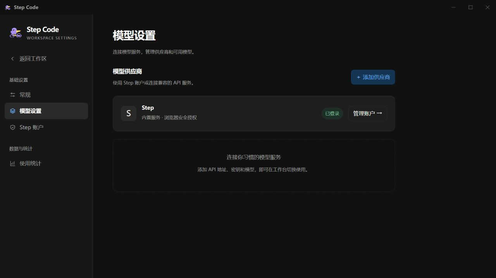
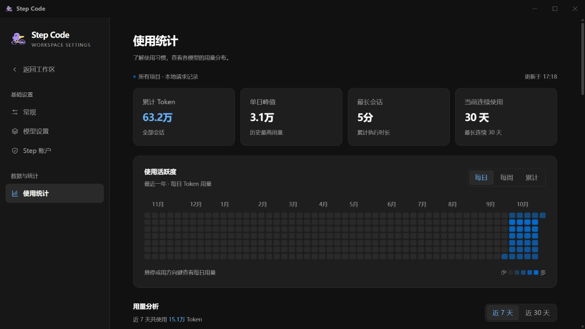

# Step Code RS

**Step Code RS** 是一个桌面 AI 编程助手。打开本地项目，用自然语言描述需求，让 AI 帮你理解代码、修复问题和实现功能。

## 快速开始

[下载安装包](https://github.com/vnt-dev/step-code-rs/releases)，支持 Windows 和 macOS。模型服务可通过 Step 账户登录，也可在设置中配置自己的 API。连接模型后，即可围绕本地项目发起编程任务。

## 主要功能

- **AI 编程**：阅读代码、修改文件、执行命令，协助完成开发任务。
- **多模型支持**：使用 Step 账户或连接自己的模型服务。
- **项目与聊天管理**：按项目保存聊天记录，随时继续之前的工作。
- **图片与联网搜索**：结合截图描述需求，搜索相关资料。
- **执行控制**：选择权限模式，确认操作并审阅计划。
- **使用统计**：查看模型用量与响应速度。

## 客户端界面

### 工作区

### 模型设置

### 使用统计

## 许可证

本项目采用 [MIT License](LICENSE)。
